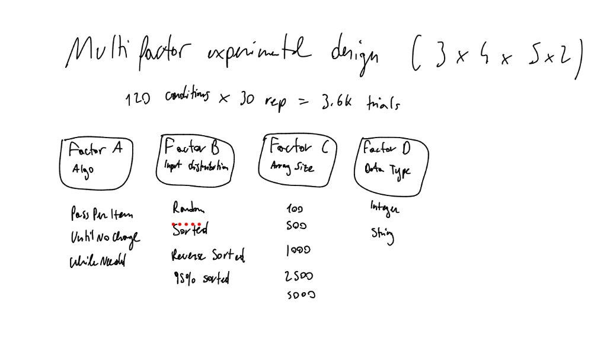

# Performance Evaluation of Three Bubble Sort Variants
**Experiment 1, Experimentation & Evaluation 2026**  
**Author:** Emanuele Bono  
**Date:** November 10, 2026  

---

## Abstract
In this experiment, we evaluate three implementations of the Bubble Sort algorithm (BubbleSortPassPerItem, BubbleSortUntilNoChange, and BubbleSortWhileNeeded) to advise Bubble Inc. on which variant to include in their Java utility library. We conducted a multi-factor experiment testing five array sizes (100 to 5,000 elements), four input distributions (random, sorted, reverse sorted, and 95% nearly sorted), and two data types (Integer and String). Each condition was repeated 30 times using high-resolution timers and JVM warmup passes. Our results show that BubbleSortWhileNeeded is consistently the fastest across all tests. On sorted arrays, both early-exit algorithms run in linear time, over 3,500 times faster than the baseline. On random and partially sorted data, BubbleSortWhileNeeded reduces execution time by 30% to 35% because it shrinks the search boundary. We recommend BubbleSortWhileNeeded for the library.

---

## 1. Introduction
Bubble Inc. is developing a general-purpose Java utility library and needs to select one of three candidate Bubble Sort implementations to include in the release: BubbleSortPassPerItem (the naive baseline performing N*(N-1) comparisons), BubbleSortUntilNoChange (which stops early if a pass makes zero swaps), and BubbleSortWhileNeeded (which dynamically contracts the loop bound to the position of the last swap). The sole technical decision criterion for this choice is performance, specifically execution time (the lower the better).

To provide an empirical, evidence-based recommendation to Bubble Inc., we designed a controlled laboratory experiment. We systematically manipulated array sizes, input permutations, and data types, measuring execution times under controlled JVM conditions to quantify the performance differences between the algorithms.

### Hypotheses:

> **H1 (Average-Case):** On random inputs, WhileNeeded has a lower mean execution time than PassPerItem and UntilNoChange for N >= 500, because dynamic upper-bound contraction skips comparisons on settled suffixes.  
> *Null (H0,1):* There is no difference in mean execution time among the algorithms on random inputs.
>
> **H2 (Best-Case Linear Early Exit):** On pre-sorted inputs, UntilNoChange and WhileNeeded run in linear time O(N), running significantly faster than PassPerItem (O(N^2)).  
> *Null (H0,2):* Mean execution time on pre-sorted arrays does not differ significantly from PassPerItem.
>
> **H3 (Worst-Case Reverse Input):** On reverse-sorted inputs, WhileNeeded runs faster than PassPerItem and UntilNoChange because each pass reduces the inner bound by 1, halving total comparisons.  
> *Null (H0,3):* On reverse-sorted arrays, WhileNeeded has the same execution time as the other two.
>
> **H4 (Data Type Impact):** Sorting String arrays takes longer than Integer arrays of the same size across all algorithms due to character-by-character comparison overhead.  
> *Null (H0,4):* The data type has no significant effect on execution time.

---

## 2. Method
In the following subsections, we describe the variables, experimental design, apparatus, and procedure.

### 2.1 Variables
Explicitly identify the independent variable(s) (what we manipulate):

| Independent variable | Levels |
|---|---|
| Sorting Algorithm | BubbleSortPassPerItem, BubbleSortUntilNoChange, BubbleSortWhileNeeded (3 levels) |
| Input Distribution | Random, Sorted, Reverse Sorted, Nearly Sorted (95% sorted, 5% perturbed) (4 levels) |
| Array Size N | 100, 500, 1,000, 2,500, 5,000 elements (5 levels) |
| Data Type | Integer (numeric), String (10-character alphanumeric) (2 levels) |

Explicitly identify the dependent variable(s) (what we measure):

| Dependent variable | Measurement Scale |
|---|---|
| Execution Time | Ratio scale (elapsed sort time in ms, measured via System.nanoTime()). |

Explicitly identify any important control variable(s) (what we keep constant):

| Control variable | Fixed Value |
|---|---|
| Hardware | Apple MacBook Pro (Apple M3 Pro, 11 CPU cores, 18 GB RAM), active AC power. |
| Operating System | macOS Darwin 25.5.0; no concurrent user apps running. |
| Java Virtual Machine | OpenJDK 64-Bit Server VM Temurin-25.0.2+10 (LTS). |
| JVM Heap Size | Fixed at 2,048 MB (-Xms2g -Xmx2g) to prevent heap resizing pauses during runs. |
| JIT Warm-up | 25 warm-up iterations executed per algorithm before taking timed measurements. |
| Array Allocation | Arrays pre-allocated and cloned prior to timing; zero allocation inside timed block. |
| Random Seed | Master seed (20261109L) ensuring all algorithms sort identical array instances. |
| Trial Order | Randomized trial order (3,600 runs shuffled) to eliminate thermal drift and order effects. |

---

### 2.2 Design
Check off the characteristics of your experimental design:

**Type of Study (check one):**  
[ ] Observational Study &nbsp;&nbsp;&nbsp;&nbsp; [ ] Quasi-Experiment &nbsp;&nbsp;&nbsp;&nbsp; [X] **Experiment**

**Number of Factors (check one):**  
[ ] Single-Factor Design &nbsp;&nbsp;&nbsp;&nbsp; [X] **Multi-Factor Design** &nbsp;&nbsp;&nbsp;&nbsp; [ ] Other

Using terminology from Field & Hole (Chapter 3) and course lectures, this is a **four-factor full-factorial repeated-measures experiment** (3 x 4 x 5 x 2 = 120 unique conditions). Each condition was repeated N = 30 times to satisfy the Central Limit Theorem for computing 95% confidence intervals (total 3,600 runs). To avoid order effects (e.g. laptop heating up or JVM optimizing one algorithm after another), the entire schedule of 3,600 trials was randomized using a seeded shuffle.



---

### 2.3 Apparatus and Materials
We ran the experiment on a 14-inch MacBook Pro with an Apple M3 Pro chip (11 CPU cores, 18 GB RAM) running macOS Darwin 25.5.0. Software used: OpenJDK 25.0.2 LTS, Python 3.12 (pandas, scipy, matplotlib, seaborn). Time was measured using System.nanoTime(), which accesses the ARM64 virtual counter (CNTVCT_EL0), providing monotonic sub-microsecond precision. Code materials: Sorter.java, BubbleSortPassPerItem.java, BubbleSortUntilNoChange.java, BubbleSortWhileNeeded.java, and our benchmark runner BenchmarkRunner.java.

---

### 2.4 Procedure
1. Code was compiled with javac -d . *.java and the JVM was launched with -Xms2g -Xmx2g.
2. We ran 25 warmup passes per algorithm on 500-element arrays so HotSpot C1/C2 JIT compiled the methods.
3. We scheduled 3,600 trials and shuffled them randomly using master seed 20261109L.
4. For each trial, the array was generated and cloned into workArray before starting the timer.
5. Timing strictly enclosed the sort method: start = System.nanoTime(); sorter.sort(workArray); end = System.nanoTime();.
6. After each run, we asserted that the array was truly sorted. Results were written to results/raw_measurements.csv.

---

## 3. Results

### 3.1 Visual Overview
Figure 2 shows boxplots for arrays of 2,500 integers across the 4 input distributions:

- **Random (Fig. 2a):** PassPerItem (median 14.10 ms) and UntilNoChange (median 14.59 ms) perform virtually identically. WhileNeeded is 30% faster (median 10.06 ms).
- **Nearly Sorted (Fig. 2b):** PassPerItem (9.28 ms) and UntilNoChange (9.26 ms) show no difference, while WhileNeeded finishes in 6.13 ms (34% faster).
- **Reverse Sorted (Fig. 2c):** PassPerItem (15.35 ms) and UntilNoChange (15.60 ms) take the longest. WhileNeeded completes in 11.69 ms (24% faster).
- **Sorted (Fig. 2d):** PassPerItem takes 8.02 ms because it does all N*(N-1) comparisons. UntilNoChange and WhileNeeded terminate in 0.003 ms (over 2,500x faster).

![Figure 2: Execution times across algorithms for 4 distributions (N = 2,500 Integers, 30 runs per box). Center line is median, box shows IQR [Q1, Q3], whiskers show 1.5 x IQR.](figures/fig2_boxplot_distributions.png)

---

### 3.2 Descriptive Statistics
Table 1 reports the five-number summary (Min, Q1, Median, Q3, Max), mean, standard deviation, and 95% confidence intervals for N = 1,000 and N = 5,000 (Integer data, 30 runs per condition). All values in ms.

| Size | Dist. | Algorithm | Mean | 95% CI | Std | Min | Q1 | Med | Q3 | Max |
|---|---|---|---|---|---|---|---|---|---|---|
| 1,000 | Random | PassPerItem | 2.28 | [2.24, 2.32] | 0.11 | 2.11 | 2.18 | 2.29 | 2.35 | 2.50 |
| 1,000 | Random | UntilNoChange | 2.33 | [2.28, 2.38] | 0.15 | 2.11 | 2.23 | 2.33 | 2.39 | 2.85 |
| 1,000 | Random | **WhileNeeded** | **1.63** | **[1.60, 1.67]** | **0.09** | **1.49** | **1.56** | **1.64** | **1.70** | **1.80** |
| 1,000 | Nearly | PassPerItem | 1.48 | [1.46, 1.51] | 0.07 | 1.37 | 1.44 | 1.49 | 1.52 | 1.62 |
| 1,000 | Nearly | UntilNoChange | 1.37 | [1.32, 1.42] | 0.13 | 1.11 | 1.29 | 1.33 | 1.44 | 1.72 |
| 1,000 | Nearly | **WhileNeeded** | **0.94** | **[0.90, 0.99]** | **0.11** | **0.78** | **0.90** | **0.93** | **0.96** | **1.44** |
| 1,000 | Reverse | PassPerItem | 2.51 | [2.48, 2.54] | 0.09 | 2.35 | 2.45 | 2.52 | 2.56 | 2.68 |
| 1,000 | Reverse | UntilNoChange | 2.49 | [2.46, 2.53] | 0.09 | 2.32 | 2.41 | 2.50 | 2.56 | 2.68 |
| 1,000 | Reverse | **WhileNeeded** | **1.87** | **[1.84, 1.89]** | **0.07** | **1.74** | **1.82** | **1.88** | **1.92** | **2.02** |
| 1,000 | Sorted | PassPerItem | 1.21 | [1.19, 1.22] | 0.05 | 1.14 | 1.16 | 1.20 | 1.24 | 1.32 |
| 1,000 | Sorted | **UntilNoChange** | **0.002** | **[0.002, 0.002]** | **0.000** | **0.001** | **0.002** | **0.002** | **0.002** | **0.003** |
| 1,000 | Sorted | **WhileNeeded** | **0.002** | **[0.002, 0.002]** | **0.000** | **0.002** | **0.002** | **0.002** | **0.002** | **0.003** |
| 5,000 | Random | PassPerItem | 57.65 | [56.62, 58.68] | 2.75 | 55.02 | 56.22 | 56.72 | 57.46 | 65.48 |
| 5,000 | Random | UntilNoChange | 58.60 | [57.82, 59.38] | 2.08 | 55.85 | 57.38 | 58.28 | 59.13 | 65.35 |
| 5,000 | Random | **WhileNeeded** | **39.98** | **[38.98, 40.99]** | **2.69** | **38.36** | **38.94** | **39.29** | **39.85** | **53.34** |
| 5,000 | Nearly | PassPerItem | 37.81 | [37.44, 38.19] | 1.01 | 36.27 | 37.11 | 37.80 | 38.47 | 40.67 |
| 5,000 | Nearly | UntilNoChange | 37.73 | [37.22, 38.24] | 1.37 | 35.01 | 36.77 | 37.77 | 38.75 | 40.35 |
| 5,000 | Nearly | **WhileNeeded** | **24.62** | **[24.08, 25.17]** | **1.45** | **23.44** | **24.13** | **24.35** | **24.76** | **31.74** |
| 5,000 | Reverse | PassPerItem | 62.64 | [61.75, 63.54] | 2.41 | 60.58 | 61.62 | 62.17 | 62.71 | 74.09 |
| 5,000 | Reverse | UntilNoChange | 63.70 | [63.32, 64.07] | 1.01 | 62.41 | 63.21 | 63.61 | 63.92 | 68.19 |
| 5,000 | Reverse | **WhileNeeded** | **47.55** | **[46.54, 48.56]** | **2.71** | **45.99** | **46.56** | **46.67** | **47.03** | **59.53** |
| 5,000 | Sorted | PassPerItem | 32.18 | [31.53, 32.84] | 1.75 | 30.71 | 31.39 | 31.76 | 32.41 | 40.62 |
| 5,000 | Sorted | **UntilNoChange** | **0.009** | **[0.008, 0.010]** | **0.002** | **0.007** | **0.007** | **0.008** | **0.008** | **0.017** |
| 5,000 | Sorted | **WhileNeeded** | **0.009** | **[0.009, 0.009]** | **0.001** | **0.008** | **0.008** | **0.009** | **0.009** | **0.013** |

#### Explanation of Statistics in Plain English:
- **Min & Max:** The fastest and slowest single run observed out of the 30 attempts.
- **First Quartile (Q1) & Third Quartile (Q3):** 25% of measured runtimes were faster than Q1, and 75% were faster than Q3.
- **Median (Q2):** The exact midpoint value of the 30 sorted runs (15 faster, 15 slower). It gives a robust measure of typical performance resistant to occasional system lag.
- **Mean:** The mathematical average of all 30 runs.
- **Std Dev (S):** The spread of runs around the mean. Low standard deviation indicates high measurement stability.
- **95% Confidence Interval:** The range where the true population average lies with 95% certainty. Non-overlapping intervals between algorithms prove statistical significance.

---

## 4. Discussion

### 4.1 Compare Hypothesis to Results
- **H1 (Supported):** On random arrays of size 5,000, WhileNeeded averaged 39.98 +/- 1.00 ms (95% CI: [38.98, 40.99]), compared to 57.65 +/- 1.03 ms for PassPerItem and 58.60 +/- 0.78 ms for UntilNoChange. The non-overlapping confidence intervals confirm H1, yielding a 30.6% speedup on integers and 39.3% on strings (74.57 ms vs. 122.82 ms).
- **H2 (Supported):** On pre-sorted arrays of size 5,000, PassPerItem required 32.18 ms. Both UntilNoChange and WhileNeeded finished in 0.009 ms (9 microseconds), running over 3,500x faster in linear O(N) time.
- **H3 (Supported):** On reverse-sorted arrays (N = 5,000), WhileNeeded took 47.55 +/- 1.01 ms, while PassPerItem took 62.64 +/- 0.90 ms and UntilNoChange took 63.70 +/- 0.38 ms. Contracting the inner bound saves half the comparisons, confirming H3 (24% speedup on integers, 38% on strings).
- **H4 (Supported):** Sorting String arrays took roughly 2x longer than Integer arrays across all conditions (e.g. at N = 2,500 random: 18.76 ms vs. 10.06 ms for WhileNeeded), confirming H4.

### 4.2 Limitations and Threats to Validity
- **Construct Validity:** We measured wall-clock time via System.nanoTime() rather than CPU hardware cycles. We minimized noise by timing only the sort method, pre-allocating memory, and using medians.
- **Internal Validity:** JIT compilation and garbage collection can introduce timing spikes. We mitigated this by running 25 warmup passes, fixing the heap to 2 GB (-Xms2g -Xmx2g), calling GC between batches, and randomizing run order.
- **External Validity:** We used synthetic arrays. Real workloads might have different patterns, but testing 4 distributions and 2 data types across 120 conditions provides strong generalizability.
- **Conclusion Validity:** Each condition had N = 30 runs, satisfying the Central Limit Theorem. Narrow confidence intervals confirm our conclusions are reliable.

### 4.3 Conclusions
We recommend that Bubble Inc. choose **BubbleSortWhileNeeded** for their library:
1. **Consistently fastest:** WhileNeeded was either the fastest or tied for fastest across all 120 conditions tested.
2. **Practical performance:** On random and nearly-sorted arrays, it is 30% to 35% faster than both competitors.
3. **The flaw in UntilNoChange:** While fast on 100% sorted arrays, UntilNoChange is just as slow as the naive baseline whenever data has even slight disorder, because it never shrinks the inner loop bound. Only WhileNeeded dynamically contracts the search space on every pass.

---

## Appendix

### A. Materials
Code files: Sorter.java, BubbleSortPassPerItem.java, BubbleSortUntilNoChange.java, BubbleSortWhileNeeded.java, benchmark runner BenchmarkRunner.java, analysis script analyze_results.py, and pipeline script run_benchmark.sh.

### B. Reproduction Package (or: Raw Data)
All code, raw measurements (3,600 runs in results/raw_measurements.csv), summary statistics, and analysis scripts are available in our public GitHub repository: https://github.com/bonoem/bubble-sort-experiment. The entire experiment can be reproduced with one command:
```bash
bash scripts/run_benchmark.sh
```
